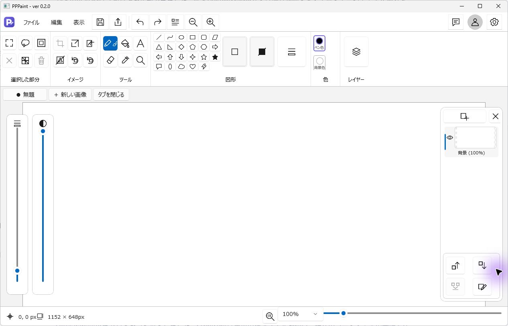
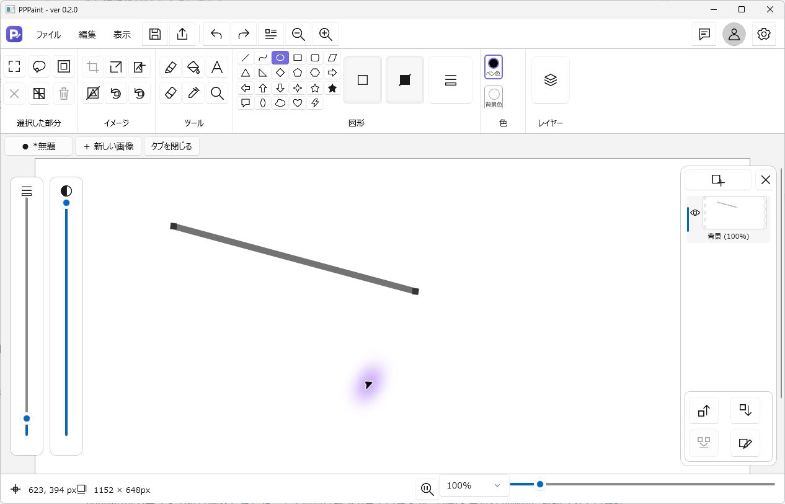
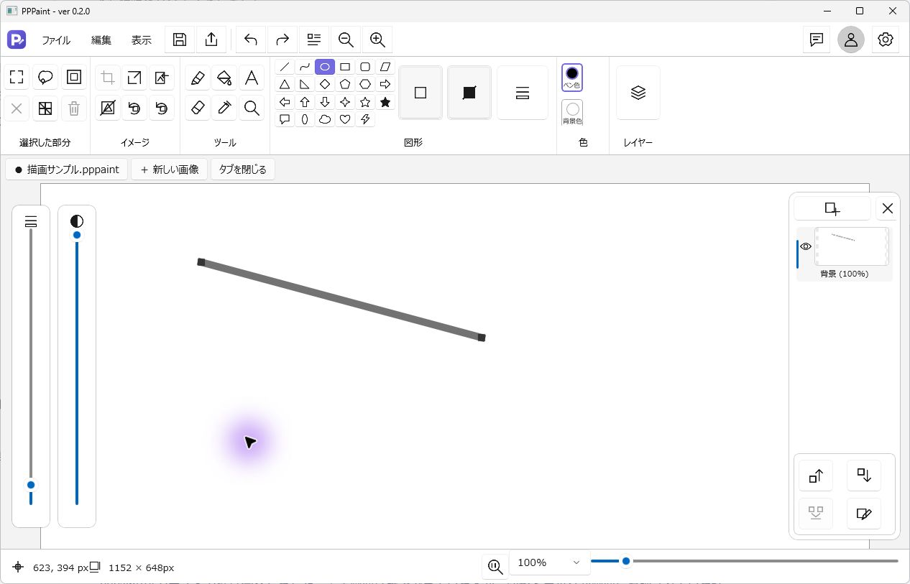
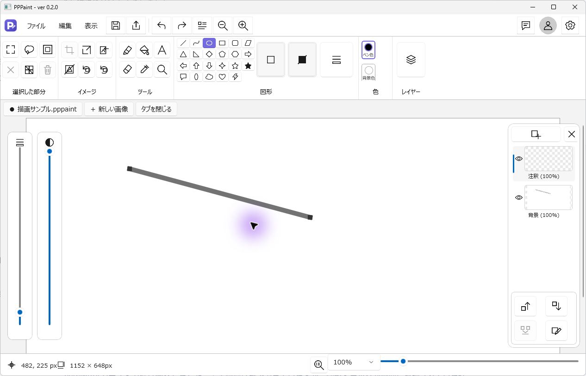
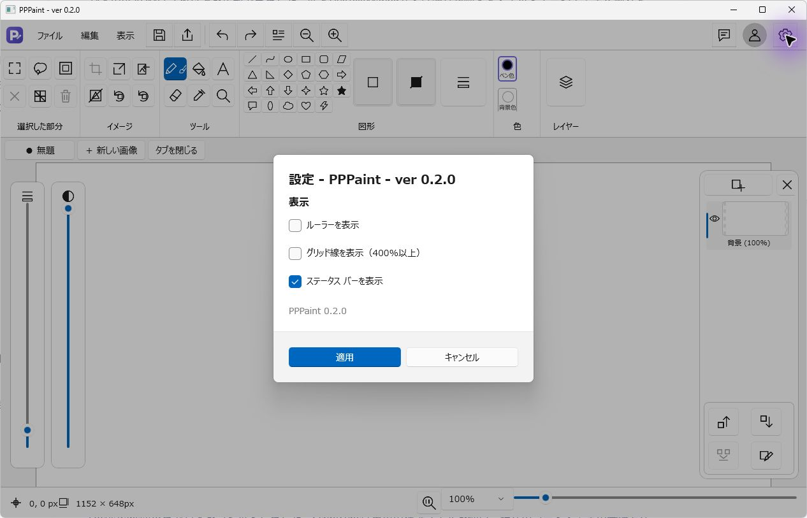

# PPPaint

Windows向けのスクリーンショット編集ツールです。画像を切り抜いたり、矢印・枠・文字・番号で注釈を付けたり、不要な情報を隠したりできます。編集結果はコピーするか、PNG/JPEG形式で保存できます。現行版は **v0.2.35** です。

## 起動と基本操作

ローカル配布フォルダーの `artifacts/release/v0.2.35/win-x64/Start-PPPaint.cmd` を実行します。自己完結型の非MSIX版で、別途.NETランタイムの導入や管理者権限は不要です。リポジトリの取得だけでは配布フォルダーは生成されません。[開発・検証](docs/development.md)にビルド手順があります。

1. Ctrl+Vでクリップボードの画像を重ねるか、「ファイル▼」から画像を開きます。
2. 矢印・四角・丸・文字・番号などで注釈を付けます。「選択・移動」で後から調整できます。
3. 必要な部分を「矩形範囲」で囲み、Ctrl+Shift+Xで切り抜きます。図形を選択して外周に沿って切り抜くこともできます。
4. 情報を隠すときは「四角」横の▼で「塗りつぶし（情報隠し）」を選び、不透明に覆います。
5. Ctrl+Cでコピー、Ctrl+Sで保存します。選択図形だけのコピーとキャンバス全体のコピーの違いは[利用ガイド](docs/user-guide.md)を参照してください。

## 主な機能

- ペン、消しゴム、矢印、四角、丸、直線、文字、番号、蛍光ペン、ぼかし、吹き出し、モザイク、スポイト。文字の不透明度は変更できます。
- 四角・丸・矢印・番号は▼で形状や塗りつぶしを変更。矢印は4種類、番号は丸・四角・囲みなし。吹き出しは本文と尾を別々に調整でき、文字量に合わせて本文枠が広がります。
- 囲った範囲内の見えている内容を画像として切り離して移動。スポイトはドラッグ中に色を表示し、離した地点で確定します。
- 図形と画像の再選択、移動、サイズ変更、複製、前後の順序変更、画像への統合、元に戻す・やり直し。
- Ctrl+Vで重ね貼り。Ctrl+Shift+V／貼り付け横の▼で重ねる・上・下・左・右の５方式を選択。重ね貼りではキャンバスを縮小しません。
- 左下の寸法やキャンバス外枠から、余白追加・切り詰め。背景色と透明にも対応。右下のバー／Ctrl+ホイールは表示倍率の変更です。
- キャンバスサイズ画面の８方向プレビューは画像位置を固定し、切り取り線をドラッグできます。プレビュー倍率は既定1倍、縦横比固定は既定OFF。「リセット」（Alt+E）で未適用の変更を戻せます。
- 太さ・文字サイズ・効果の数値はツール別に保存し、再起動後も復元。番号は画像ごとに1から始まります。

保存するときや外部へコピーするときは、編集結果を１枚の画像に合成します。同じプロセスで最後にコピーした内容は図形として再編集できますが、PNG/JPEGを開き直しても個別の図形には戻りません。

## 設定と並行起動

通常ランチャーの設定先は `%LOCALAPPDATA%\PPPaint\profiles\editor` です。旧版で未保存の画像を編集中なら、同梱の `Start-PPPaint-Parallel.cmd` でv0.2.35を別起動できます。こちらは `profiles\editor-v0.2.35` を使い、通常版との設定変更は同期しません。ランチャー自体は設定を複製しません。

画像・設定・保存前バックアップの扱いは[プライバシーと権限](PRIVACY.md)を参照してください。

## はじめて描く

ここから「困ったとき」までの画面例と操作は0.2.0が対象です。起動すると白いキャンバスが開きます。上にツール、右にレイヤー、下に画像サイズとズーム倍率があります。「新しい画像」で別の画像タブを作れます。

鉛筆のボタンからブラシを選び、キャンバスをドラッグします。左側のスライダーで線幅と不透明度を調整できます。間違えたら `Ctrl+Z`、やり直すときは `Ctrl+Y` を使います。以下はマーカーで線を描いた例です。

## 保存する

保存ボタンまたは `Ctrl+S` を押し、名前と保存先を選びます。編集を続ける場合は `.pppaint` を選んでください。保存後はタブにファイル名が表示され、未保存を示す `*` が消えます。

## レイヤーを分ける

右のレイヤーパネル上部の「追加」で透明なレイヤーを作れます。下部の名前変更ボタンで「注釈」などの名前を付けると、背景と描き足す内容を区別できます。目のアイコンで表示を切り替えます。

## 表示を調整する

右上の歯車から設定を開き、ルーラー・グリッド線・ステータスバーを選んで「適用」を押します。グリッド線は400%以上に拡大したときに表示します。

## 困ったとき

- 描けないときは、選択中のツール、レイヤーのロック、不透明度を確認してください。
- 図形は少し時間をかけてドラッグします。短すぎるドラッグは誤操作として取り消されます。
- 保存前に終了すると確認が表示されます。残したい画像は保存してください。
- AI編集は接続先・モデル・APIキーを設定し、送信画像を確認して同意した場合だけ実行します。通常の描画には不要です。

詳細な変更内容は[リリースノート](docs/v0.2.0-release-notes.md)、ビルド・検証・追加の配布形式は[開発者ガイド](docs/development.md)を参照してください。

## ドキュメント

| 目的 | 資料 |
|---|---|
| 操作方法を知る | [利用ガイド](docs/user-guide.md)、[キー割当と根拠](docs/keyboard-shortcuts.md) |
| 更新内容を見る | [変更履歴](CHANGELOG.md)、[v0.2.35の変更内容](docs/v0.2.35-release-notes.md) |
| 開発・検証する | [開発・検証](docs/development.md)、[開発手順](dev/pppaint-development-procedure.md) |
| 仕様・実績・過去資料を探す | [ドキュメント一覧](docs/README.md) |

## ライセンス

アプリ本体は[LICENSE](LICENSE)を参照してください。WinUI / Windows App SDK、Win2D、.NET、WebP読み込み用のSkiaSharpにはそれぞれのライセンスが適用されます。配布物へ第三者ライセンスの通知を同梱します。
